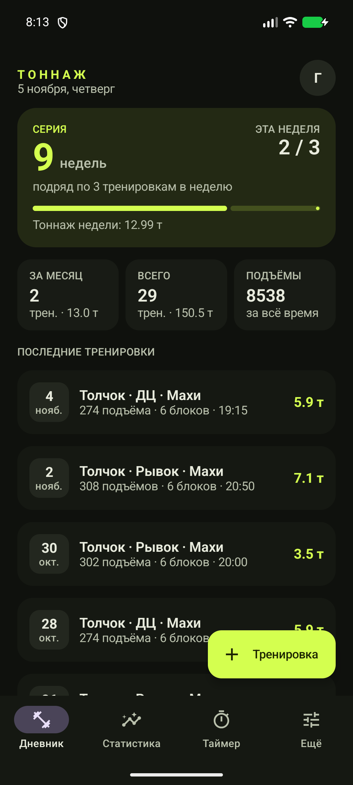
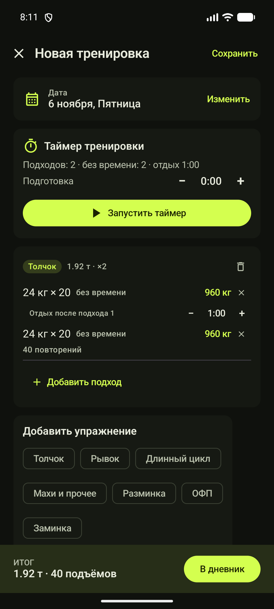
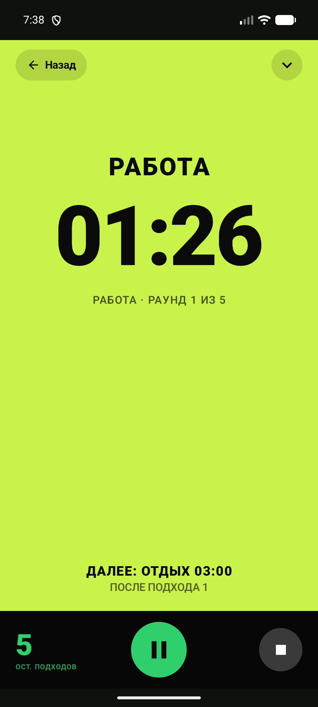

# ГириБро — гиревой дневник для Android (прототип)

Нативное Android-приложение на Kotlin + Jetpack Compose. Сделано как самостоятельный
аналог Telegram mini-app «ГИРИ»: те же базовые идеи — дневник тренировок, тоннаж,
серия недель, интервальный таймер и статистика, но без копирования кода и ассетов
чужого продукта.

Это **рабочий прототип**, а не релизная версия. Он собирается в APK, запускается на
телефоне, хранит данные локально и не требует сервера.

## Скриншоты

| Дневник | Новая тренировка | Статистика | Таймер |
|---|---|---|---|
|  |  |  |  |

Ещё: [редактирование](docs/edit-workout.png), [повтор тренировки](docs/repeat-workout.png),
[таймер тренировки](docs/workout-timer.png), [подход с двумя гирями](docs/new-workout-two-bells.png),
[настройки](docs/settings.png), [светлая тема](docs/light-theme.png),
[конструктор без подходов](docs/new-workout.png), [таймер до старта](docs/timer.png).

## Что уже работает

- **Дневник**: серия недель, цель на неделю, тоннаж за неделю и месяц, последние
  тренировки, карточка тренировки с разбивкой по подходам, редактированием,
  повтором и удалением.
- **Конструктор тренировки**: толчок, рывок, длинный цикл, махи, разминка, ОФП,
  заминка; произвольное число подходов (вес × повторы × время); свой отдых после
  каждого подхода с шагом 15 секунд; авторасчёт объёма, времени под нагрузкой
  и тоннажа.
- **Время подхода**: длительность каждого подхода вводится в минутах и секундах,
  суммируется по упражнению, тренировке и выбранному периоду статистики. Время
  можно не указывать: тогда таймер ждёт подтверждения подхода кнопкой
  «Выполнено».
- **Формулы**: объём = вес × подъёмы; толчок и длинный цикл считаются за две гири
  (×2), у длинного цикла ещё коэффициент 1.6; разминка и ОФП не входят в тоннаж;
  махи считаются отдельным объёмом.
- **Интервальный таймер**: работа / отдых / раунды / подготовка, звук, вибрация,
  foreground-сервис — переживает сворачивание приложения и показывает прогресс
  в уведомлении.
- **Таймер под тренировку**: из подходов, их времени и индивидуального отдыха
  собирается последовательность «упражнение → отдых → следующее упражнение».
  Полноэкранный таймер крупно показывает фазу, обратный отсчёт и следующий шаг,
  умеет ставиться на паузу, продолжает работу в фоне и управляется из уведомления.
  Подход без времени показывается как задание с кнопкой «Выполнено»; после
  подтверждения таймер переходит к отдыху и следующему подходу. Черновик
  тренировки при этом не теряется.
- **Повтор тренировки**: сохранённую тренировку можно открыть в конструкторе,
  поправить и сохранить как новую; дата подставляется сегодняшняя.
- **Статистика**: выбор периода (7 дней, 30 дней, 3 месяца, год, всё время),
  тоннаж и время под нагрузкой, график, разбивка по упражнениям, рекорды
  (лучшая тренировка, серия, средний тоннаж).
- **Настройки**: тёмная/светлая/системная тема, недельная цель, вес по умолчанию,
  очистка дневника.
- **Демо-данные** при первом запуске, чтобы интерфейс не был пустым.

## Чего в прототипе нет

- Аккаунтов и облачной синхронизации — всё лежит в локальной Room-базе.
- Ленты товарищей, лайков, комментариев и рейтингов.
- Нормативов ЕВСК, календаря соревнований, новостей ВФГС.
- Импорта GPX/TCX/Polar и фото-карточек тренировок.
- ИИ-заполнения и генератора программ.
- Кардио-тренировок (бег, вело, плавание).

## Сборка и установка

Требования: JDK 17, Android SDK 34. Всё остальное подтянет Gradle.

```powershell
cd D:\Python\GiriBro
.\gradlew.bat assembleDebug
```

APK: `app\build\outputs\apk\debug\app-debug.apk`

Установка на подключённый телефон:

```powershell
adb install -r app\build\outputs\apk\debug\app-debug.apk
```

Тесты расчётов и логики:

```powershell
.\gradlew.bat testDebugUnitTest
```

## Структура

```
app/src/main/java/ru/petproject/giribro/
├─ MainActivity.kt          вход, тема, edge-to-edge
├─ GiriBroApp.kt            Application, DI-контейнер, демо-данные
├─ AppViewModel.kt          состояние экранов и операции с дневником
├─ data/
│  ├─ Models.kt             SectionType, Section, SetEntry, Workout, форматирование
│  ├─ WorkoutEntity.kt      Room-сущность + JSON-сериализация секций
│  ├─ WorkoutDao.kt         Room DAO
│  ├─ AppDatabase.kt        база
│  ├─ WorkoutRepository.kt  репозиторий
│  ├─ SettingsRepository.kt SharedPreferences + StateFlow
│  └─ DemoData.kt           стартовые тренировки
├─ timer/
│  ├─ TimerState.kt         конфиг, состояние, ручные подходы
│  ├─ TimerPlan.kt          фазы, план из тренировки, отдых после каждого подхода
│  ├─ TimerService.kt       foreground-сервис, звук, вибрация, уведомление
│  └─ TimerNotifications.kt канал уведомлений
├─ ui/
│  ├─ AppRoot.kt            нижняя навигация и NavHost
│  ├─ theme/                Material 3, тёмная и светлая схемы
│  ├─ components/           бейджи, плитки, заголовки, полноэкранный таймер
│  └─ screens/              дневник, конструктор, таймер, статистика, настройки
└─ util/Stats.kt            серия, лучшая серия, форматирование
```

Стек: Kotlin 1.9.24, Compose BOM 2024.09, Material 3, Navigation Compose, Room 2.6.1,
Coroutines/StateFlow, minSdk 26, targetSdk 34.

## Дорожная карта и оценка

Оценка для одного разработчика, включая тестирование и полировку.

| Этап | Содержание | Оценка |
|---|---|---|
| Прототип | этот репозиторий | готов |
| MVP до релиза | вход, облако, синхронизация, обработка ошибок, тесты, Play internal testing | 3–4 недели |
| Соцфид | подписки, лента, лайки, комментарии, рейтинги, модерация | 2–3 недели |
| Нормативы и календарь | ЕВСК, календарь ВФГС, новости | 1–2 недели |
| Импорт тренировок | GPX/TCX/JSON, Polar Flow | 1–2 недели |
| Фото-карточки | шаблоны, экспорт, шаринг | ~1 неделя |
| ИИ-заполнение | парсер текста в подходы | 1–2 недели |
| Генератор программ | методики, периодизация | 2–3 недели |
| **Полный аналог** | всё выше + бэкенд | **2,5–3,5 месяца** |

Бэкенд для облака — отдельные 2–3 недели: Django/DRF + PostgreSQL, авторизация,
хранение фото, синхронизация и офлайн-очередь изменений.

## Правовая заметка

«ГИРИ» — сторонний продукт. Здесь использованы только общие идеи предметной области
(гиревой спорт, тоннаж, интервалы). Название, иконки, тексты и код — собственные.
Перед публикацией в Google Play нужны свой бренд, политика конфиденциальности и
проверка, что функциональность не выдаётся за оригинальное приложение.
