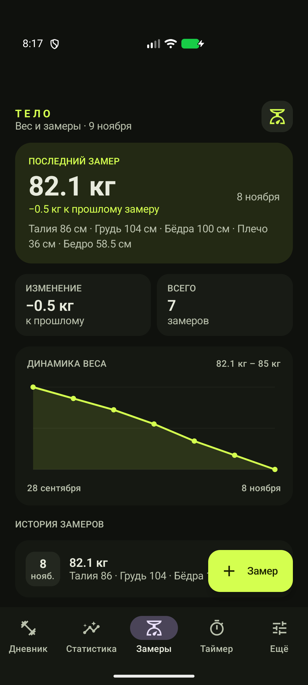
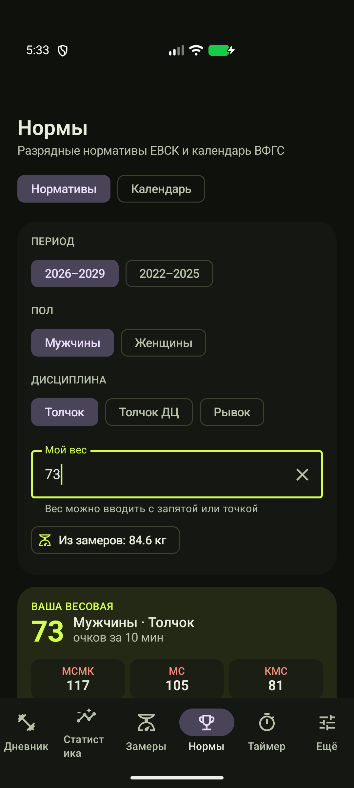
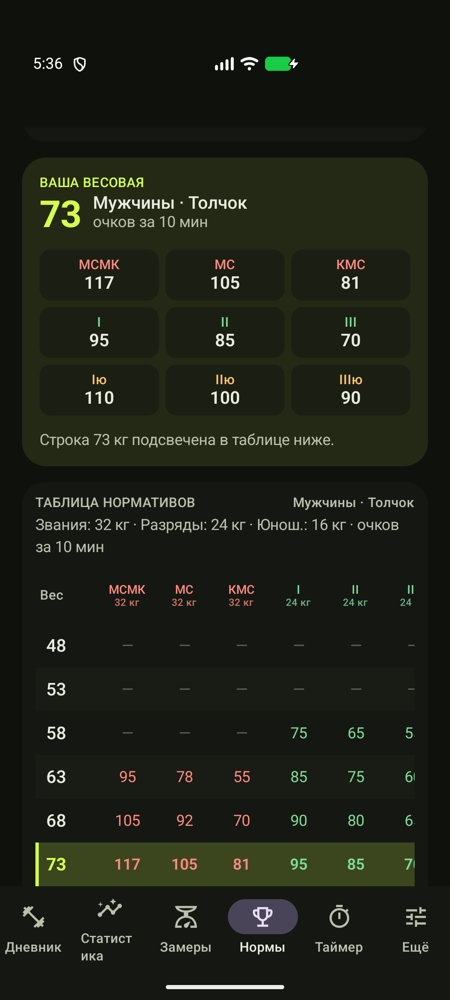
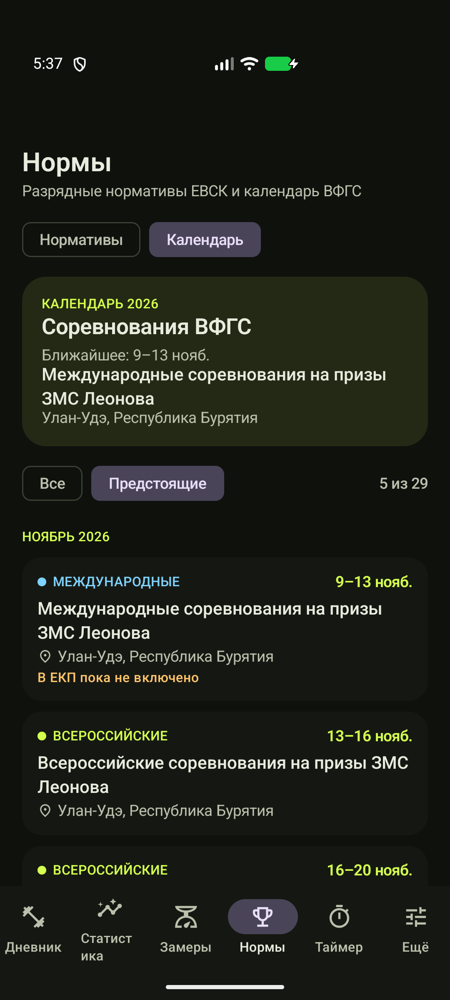
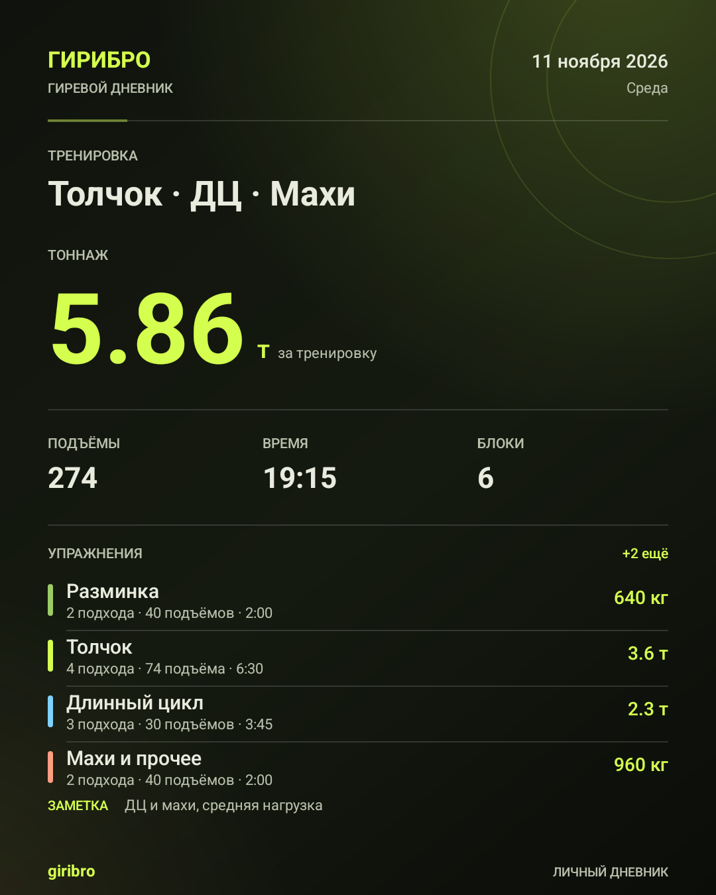
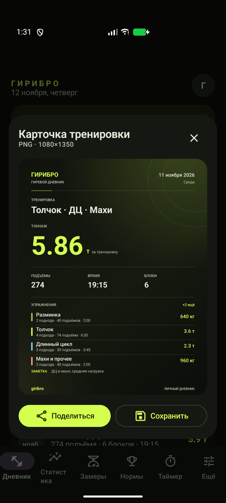

# ГириБро — гиревой дневник для Android

Нативное Android-приложение на Kotlin + Jetpack Compose. Сделано как самостоятельный
планер для гиревика: базовые идеи — дневник тренировок, тоннаж,
серия недель, интервальный таймер, статистика, вес и замеры тела, быстрый ввод
тренировки текстом, нормативы ЕВСК, календарь соревнований ВФГС, фото-карточки
тренировок, автобэкап, ярлыки быстрого запуска и счётчик повторов по камере.

Это рабочая версия для локального использования. Она собирается в APK, запускается
на телефоне, хранит данные локально и не требует сервера. Проект готовится к
публикации в RuStore; текущая версия — `0.3.0`.

## Скриншоты

| Дневник | Замеры тела | Метрики | Таймер |
|---|---|---|---|
|  |  |  |  |

| Нормативы | Таблица с подсветкой | Календарь ВФГС |
|---|---|---|
|  |  |  |

| Фото-карточка тренировки | Предпросмотр и шаринг |
|---|---|
|  |  |

Ещё: [новая тренировка](docs/new-workout-set.png),
[быстрый ввод](docs/quick-input.png), [редактирование](docs/edit-workout.png),
[повтор тренировки](docs/repeat-workout.png), [таймер тренировки](docs/workout-timer.png),
[подход с двумя гирями](docs/new-workout-two-bells.png), [настройки](docs/settings.png),
[светлая тема](docs/light-theme.png), [конструктор без подходов](docs/new-workout.png),
[таймер до старта](docs/timer.png).

## Что уже работает

- **Дневник**: серия недель, цель на неделю, тоннаж за неделю и месяц, последние
  тренировки, карточка тренировки с разбивкой по подходам, редактированием,
  повтором и удалением.
- **Фото-карточки**: из сохранённой тренировки собирается PNG 1080×1350 с датой,
  тоннажем, подъёмами, временем, разбивкой по упражнениям и заметкой. Карточка
  рисуется локально в фирменном тёмном стиле, открывается в предпросмотре,
  отправляется через системное «Поделиться» и сохраняется через файловый диалог.
  Доступ к галерее и лишние разрешения не нужны.
- **Конструктор тренировки**: толчок, рывок, длинный цикл, махи, разминка, ОФП,
  заминка; произвольное число подходов (вес × повторы × время); свой отдых после
  каждого подхода с шагом 15 секунд; авторасчёт объёма, времени под нагрузкой
  и тоннажа. Новая тренировка автосохраняется как черновик и восстанавливается
  после закрытия приложения или смерти процесса.
- **Время подхода**: длительность каждого подхода вводится в минутах и секундах,
  суммируется по упражнению, тренировке и выбранному периоду статистики. Время
  можно не указывать: тогда таймер ждёт подтверждения подхода кнопкой
  «Выполнено».
- **Быстрый ввод**: вставка нескольких упражнений текстом в формате
  `Толчок 16 5x10`, `Рывок 16 10+10+8 1:30`, `Махи 24 3x20 отдых 1:00`.
  Понимает названия упражнений и заголовки с двоеточием, `5x10`, `5 по 10`,
  `10+10+8`, время `1:30`/`90с` и отдых `1:00`/`60с`; проверяет строки,
  показывает ошибки с номером строки и добавляет подходы в текущий черновик.
- **Быстрые значения**: для толчка, ДЦ и рывка задаются свои списки веса,
  повторов и времени; новый подход наследует значения предыдущего. Списки
  редактируются в «Настройки → Быстрые значения подходов» и попадают в резервную
  копию. Для ОФП форма отдельная: название упражнения (сохраняется и предлагается
  как подсказка), вес, повторы и время — без быстрых вводов.
- **Формулы**: объём = вес × подъёмы; толчок и длинный цикл считаются за две гири
  (×2), у длинного цикла ещё коэффициент 1.3; разминка и ОФП не входят в тоннаж;
  махи считаются отдельным объёмом.
- **Интервальный таймер**: работа / отдых / раунды / подготовка, звук, вибрация,
  foreground-сервис — переживает сворачивание приложения и показывает прогресс
  в уведомлении.
- **Таймер под тренировку**: из подходов, их времени и индивидуального отдыха
  собирается последовательность «упражнение → отдых → следующее упражнение».
  Полноэкранный таймер крупно показывает фазу, обратный отсчёт и следующий шаг,
  умеет ставиться на паузу, продолжает работу в фоне и управляется из уведомления.
  Подход без времени показывается как задание с кнопкой «Выполнено»; после
  подтверждения таймер переходит к отдыху и следующему подходу. Черновик
  тренировки при этом не теряется.
- **Счётчик повторов по камере**: отдельный экран для толчка, длинного цикла и
  рывка. Фронтальная камера распознаёт скелет на устройстве (MediaPipe Pose,
  модель внутри APK), повтор засчитывается после удержания в верхней точке.
  Порог фиксации настраивается: 0,4 с «тренировочный», 0,8 с
  «соревновательный» (по умолчанию), 1,2 с «строгий». Видны время, темп,
  короткие фиксации и разбивка по рукам для рывка; ручные «+1 / −1» доступны
  всегда. Для каждого подхода тренировки выбран режим «Запись» (камера со счётом
  и видео) или «Счёт» (камера со счётом без видео); в начале подхода камера
  открывается автоматически, а таймер продолжает идти в фоне. Видео сохраняется
  только в выбранную пользователем папку через SAF и никуда не отправляется;
  без выбранной папки запись не начинается. В интервальном таймере можно
  заранее отметить раунды для ручного открытия счётчика. Счёт тренировочный
  и не заменяет судью.
- **Повтор тренировки**: сохранённую тренировку можно открыть в конструкторе,
  поправить и сохранить как новую; дата подставляется сегодняшняя.
- **Метрики**: выбор периода (7 дней, 30 дней, 3 месяца, год, всё время),
  тоннаж и время под нагрузкой, график, разбивка по упражнениям, рекорды
  (лучшая тренировка, серия, средний тоннаж). Клик по толчку, ДЦ или рывку
  в разбивке фильтрует график и сводку по этому упражнению.
- **Вес и замеры тела**: запись веса и обхватов (талия, грудь, бёдра, плечо,
  бедро), карточка последнего замера с изменением, график динамики веса,
  история, редактирование и удаление. Вес и обхваты проверяются по диапазонам,
  дата не может быть в будущем.
- **Нормативы ЕВСК**: выбор периода (2026–2029 или 2022–2025), пола, возрастной
  группы, дисциплины и веса. Подходящая весовая категория подсвечивается в
  таблице, а карточка сверху показывает все нормативы выбранной категории без
  горизонтальной прокрутки. Таблица адаптирована под телефон: столбец веса
  закреплён, колонки разрядов прокручиваются влево, юношеские разряды
  скрываются, если их нет. Пол, возрастная группа и вес сохраняются в профиле
  спортсмена и подставляются при следующем открытии. Вес можно ввести вручную
  или подставить из последнего замера.
- **Календарь ВФГС**: 29 официальных соревнований 2026 года с датами, городами
  и типами событий. По умолчанию показываются предстоящие, переключатель
  «Все» открывает весь год; ближайшее событие выделено, месяцы сгруппированы.
- **Профиль**: отдельная вкладка, из которой открываются замеры тела, нормативы,
  календарь и настройки. В ней же видны количество тренировок, замеров и
  последний вес.
- **Настройки** (в «Профиле»): тёмная/светлая/системная тема, недельная цель,
  вес по умолчанию, порог фиксации счётчика и вход в него, профиль спортсмена
  (пол, возрастная группа, вес), очистка дневника и замеров, встроенная политика
  конфиденциальности.
- **Резервная копия**: экспорт тренировок, замеров тела, профиля и настроек в
  JSON-файл через системный файловый диалог и восстановление из копии с проверкой
  формата. Формат v3 добавил профиль и необязательное шифрование паролем
  (AES-GCM + PBKDF2); копии v1/v2 читаются без изменений. Импорт заменяет
  текущий дневник, замеры, профиль и настройки одной транзакцией и сначала
  показывает, сколько записей найдено в файле.
- **Автобэкап**: еженедельная копия в выбранную пользователем папку через SAF и
  WorkManager. Пароль для копий хранится зашифрованным ключом Android Keystore,
  поэтому автобэкап работает без ввода пароля. Если копии нет дольше 30 дней,
  приложение напоминает о ней уведомлением. Без разрешения на уведомления
  автобэкап продолжает работать, но напоминание не показывается.
- **Ярлыки приложения**: долгое нажатие на иконку открывает «Новую тренировку»,
  «Таймер» и «Замеры тела» без перехода через главный экран.
- **Демо-данные** только в debug-сборке, чтобы интерфейс не был пустым при
  разработке. В release-версии первый запуск начинается с пустого дневника.
- **Обработка ошибок**: проверка веса, повторов, времени и отдыха, веса тела,
  обхватов и даты замера до сохранения, защита от повторного нажатия «Сохранить»,
  снекбары с понятным текстом при сбоях базы, настроек и запуска таймера.
  Ошибки не роняют приложение и пишутся в лог.

## Чего пока нет

- Аккаунтов и облачной синхронизации — всё лежит в локальной Room-базе.
- Ленты товарищей, лайков, комментариев и рейтингов.
- Новостей ВФГС и результатов соревнований.
- Автоматического обновления нормативов и календаря: данные вшиты в APK.
- Импорта GPX/TCX/Polar.
- ИИ-заполнения (есть только детерминированный быстрый ввод текста) и генератора
  программ.
- Кардио-тренировок (бег, вело, плавание).

## Сборка и установка

Требования: JDK 17, Android SDK 34. Всё остальное подтянет Gradle.

```powershell
cd D:\Python\GiriBro
.\gradlew.bat assembleDebug
```

APK: `app\build\outputs\apk\debug\app-debug.apk`

Установка на подключённый телефон:

```powershell
adb install -r app\build\outputs\apk\debug\app-debug.apk
```

Release-сборка с R8, минификацией и удалением неиспользуемых ресурсов:

```powershell
.\gradlew.bat assembleRelease --no-parallel
```

Подпись берётся из `keystore.properties` в корне проекта. Этот файл и каталог
`keystore/` добавлены в `.gitignore` и не должны попадать в репозиторий.
Шаблон: `keystore.properties.example`.

```properties
storeFile=keystore/giribro-release.jks
storePassword=...
keyAlias=giribro
keyPassword=...
```

Если файла нет, release собирается без подписи. Если подпись настроена, APK
лежит в `app\build\outputs\apk\release\app-release.apk`; проверить её можно так:

```powershell
apksigner verify --verbose --print-certs app\build\outputs\apk\release\app-release.apk
```

Release APK универсальный: `arm64-v8a` + `armeabi-v7a`, около 25,9 МБ
(модель позы 5,8 МБ и нативные библиотеки MediaPipe). x86/x86_64 остаются
только в debug для эмулятора. Перед публикацией проверьте состав:

```powershell
aapt2 dump badging app\build\outputs\apk\release\app-release.apk | Select-String "native-code|uses-permission"
```

В списке разрешений должен быть `CAMERA`, но не должно быть `INTERNET`.

Ключ подписи нужно сохранить в надёжном месте: без него нельзя выпускать
обновления с той же подписью. Если R8 заблокирует файл
`app\build\intermediates\dex\release\minifyReleaseWithR8\classes.dex` (бывает на
Windows), остановите Gradle, удалите каталог и повторите сборку с `--no-parallel`.

Демо-тренировки и замеры добавляются только в debug-сборке (`BuildConfig.DEBUG`).
Release-версия при первом запуске показывает пустой дневник: у пользователя нет
чужой статистики.

Публикация в RuStore: [docs/rustore.md](docs/rustore.md).

Планы развития после `0.2.0`: [docs/platform-design.md](docs/platform-design.md) —
аккаунты, синхронизация и работа тренера со спортсменами.

Политика конфиденциальности: [docs/privacy-policy.md](docs/privacy-policy.md)
и готовый для хостинга [docs/privacy-policy.html](docs/privacy-policy.html).

Тесты расчётов и логики (132 JVM-теста, без эмулятора):

```powershell
.\gradlew.bat testDebugUnitTest
```

Покрыты валидация подходов и замеров тела, JSON-сериализация тренировок,
резервные копии v1/v2/v3, шифрование и проверка пароля, профиль спортсмена,
порог фиксации в резервной копии,
черновик тренировки, статистика и серии, план таймера, отдых после каждого
подхода, состояние конструктора тренировки, парсер быстрого ввода, структура
нормативов, подбор весовой категории, календарь ВФГС, формат фото-карточки и
автомат подсчёта повторов (фиксация, дребезг, потеря позы, ручные поправки,
отметка подходов для съёмки).

### ProGuard и совместимость данных

Имена enum-констант (`SectionType`, `ThemeMode`, `StatsPeriod`, `TimerPlanSource`,
`TimerStepKind`, `FixationPreset`, `RepExercise`) сохраняются правилами в
`app/proguard-rules.pro`. Они попадают в JSON тренировок, SharedPreferences и
extras таймера, поэтому переименование R8 сломало бы чтение старых данных.
Там же закреплены классы `com.google.mediapipe.**`: нативные библиотеки ищут их
по именам JNI, и обфускация ломает распознавание позы. Правила проверены на
release-сборке: константы и классы MediaPipe остаются в dex без изменений.

Room-база теперь версии 2. Миграция 1→2 создаёт таблицу `body_measurements`
и сохраняет существующие тренировки; переход проверен на установке с 28
тренировками без замеров.

## Структура

```
app/src/main/java/ru/petproject/giribro/
├─ MainActivity.kt          вход, тема, edge-to-edge
├─ GiriBroApp.kt            Application, DI-контейнер, демо-данные в debug
├─ AppViewModel.kt          состояние экранов и операции с дневником
├─ backup/
│  ├─ BackupService.kt      ручной и автоматический бэкап, напоминания
│  ├─ BackupWorker.kt       ежедневная проверка через WorkManager
│  ├─ BackupScheduler.kt    постановка периодической задачи
│  └─ BackupNotifications.kt канал и уведомление о копии
├─ data/
│  ├─ Models.kt             SectionType, Section, SetEntry, Workout, форматирование
│  ├─ WorkoutEntity.kt      Room-сущность + JSON-сериализация секций
│  ├─ WorkoutDao.kt         Room DAO
│  ├─ BodyMeasurement.kt    модель замера, форматирование веса и обхватов
│  ├─ BodyMeasurementEntity.kt Room-сущность замера
│  ├─ BodyMeasurementDao.kt Room DAO замеров
│  ├─ BodyMeasurementRepository.kt репозиторий замеров
│  ├─ BodyMeasurementValidator.kt проверка веса, обхватов и даты
│  ├─ AppDatabase.kt        база, версия 2 и миграция 1→2
│  ├─ WorkoutRepository.kt  репозиторий тренировок
│  ├─ DiaryBackup.kt        JSON-формат v1/v2/v3, AES-GCM и PBKDF2
│  ├─ BackupRepository.kt   SAF-папка, дата копии, пароль в Keystore
│  ├─ WorkoutDraft.kt       черновик тренировки и SharedPreferences
│  ├─ QuickWorkoutParser.kt разбор текста для быстрого ввода
│  ├─ NormData.kt           нормативы ЕВСК, профиль спортсмена, подбор веса
│  ├─ CompetitionCalendar.kt календарь ВФГС 2026 и группировка по месяцам
│  ├─ WorkoutCardContent.kt данные и форматирование фото-карточки
│  ├─ WorkoutValidator.kt   проверка веса, повторов, времени и отдыха
│  ├─ SettingsRepository.kt SharedPreferences + StateFlow
│  └─ DemoData.kt           демо-тренировки и замеры для debug-сборок
├─ timer/
│  ├─ TimerState.kt         конфиг, состояние, ручные подходы
│  ├─ TimerPlan.kt          фазы, план из тренировки, отдых после каждого подхода
│  ├─ TimerService.kt       foreground-сервис, звук, вибрация, уведомление
│  └─ TimerNotifications.kt канал уведомлений
├─ ui/
│  ├─ AppRoot.kt            нижняя навигация и NavHost
│  ├─ theme/                Material 3, тёмная и светлая схемы
│  ├─ components/           бейджи, плитки, заголовки, полноэкранный таймер
│  ├─ cards/                PNG-рендер и шаринг фото-карточек
│  └─ screens/              дневник, конструктор, быстрый ввод, таймер, статистика,
│                           замеры, нормы, календарь, карточка тренировки,
│                           счётчик по камере, настройки
├─ vision/
│  ├─ PoseFrame.kt          точки скелета, индексы MediaPipe
│  ├─ PoseGeometry.kt       углы, наклон корпуса, длина корпуса
│  ├─ ExerciseProfile.kt    упражнения, пороги фиксации, профили
│  ├─ RepCounter.kt         автомат подсчёта повторов без Android
│  └─ MediaPipePoseSource.kt CameraX → MediaPipe → PoseFrame
└─ util/Stats.kt            серия, лучшая серия, форматирование
```

Стек: Kotlin 1.9.24, Compose BOM 2024.09, Material 3, Navigation Compose, Room 2.6.1,
WorkManager, DocumentFile, Coroutines/StateFlow, CameraX 1.4.1,
MediaPipe Tasks Vision 0.10.35 (`pose_landmarker_lite`), minSdk 26, targetSdk 34.

## Источники нормативов и календаря

Нормативы ЕВСК: 2026–2029 (приказ Минспорта России №299 от 03.04.2026) и
2022–2025 (приказ №6 от 11.01.2022) — локальные таблицы. Календарь — 29
спортивных соревнований из
[календарного плана ВФГС на 2026 год](https://vfgs.ru/assets/files/calendar/Kalendar_VFGS_-red_17_03.pdf)
(редакция 17.03.2026); учебно-тренировочные мероприятия в список не включены.

Данные вшиты в APK и не обновляются по сети. При изменении ЕВСК или календаря
нужен новый релиз; актуальность всегда сверяйте с официальными документами.

## Дорожная карта и оценка

Оценка для одного разработчика, включая тестирование и полировку.

| Этап | Содержание | Оценка |
|---|---|---|
| Текущая версия | этот репозиторий, `0.2.0` | готов |
| MVP до релиза | вход, облако, синхронизация, internal testing; обработка ошибок и тесты уже в этой версии | 2–3 недели |
| Соцфид | подписки, лента, лайки, комментарии, рейтинги, модерация | 2–3 недели |
| Нормативы и календарь | ЕВСК, календарь ВФГС | готов |
| Новости ВФГС | лента новостей и регламентов | ~1 неделя |
| Импорт из Polar/GPX | GPX/TCX и Polar Flow; JSON-копия уже поддерживается | 1–2 недели |
| Фото-карточки | шаблон 1080×1350, экспорт и шаринг | готов |
| Быстрый ввод | парсер текста в подходы, без ИИ | готов |
| Генератор программ | методики, периодизация | 2–3 недели |
| **Полная версия** | всё выше + бэкенд | **2,5–3,5 месяца** |

Бэкенд для облака — отдельные 2–3 недели: Django/DRF + PostgreSQL, авторизация,
хранение фото, синхронизация и офлайн-очередь изменений.

## Правовая заметка

Название, иконки, тексты и код приложения — собственные. Перед публикацией
в магазинах приложений нужны политика конфиденциальности и проверка соответствия
требованиям магазина.
