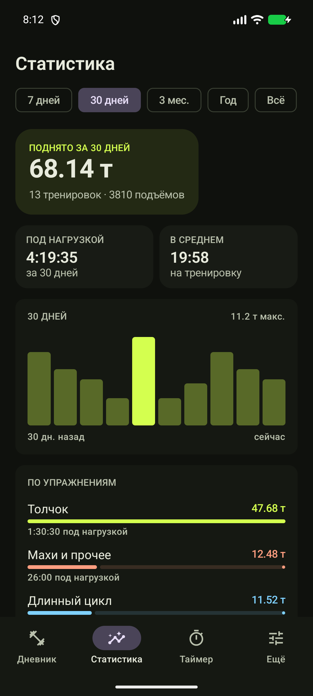

# ГириБро — гиревой дневник для Android (прототип)

Нативное Android-приложение на Kotlin + Jetpack Compose. Сделано как самостоятельный
аналог Telegram mini-app «ГИРИ»: те же базовые идеи — дневник тренировок, тоннаж,
серия недель, интервальный таймер, статистика, вес и замеры тела, быстрый ввод
тренировки текстом, но без копирования кода и ассетов чужого продукта.

Это **рабочий прототип**, а не релизная версия. Он собирается в APK, запускается на
телефоне, хранит данные локально и не требует сервера.

## Скриншоты

| Дневник | Замеры тела | Статистика | Таймер |
|---|---|---|---|
|  |  |  |  |

Ещё: [новая тренировка](docs/new-workout-set.png),
[быстрый ввод](docs/quick-input.png), [редактирование](docs/edit-workout.png),
[повтор тренировки](docs/repeat-workout.png), [таймер тренировки](docs/workout-timer.png),
[подход с двумя гирями](docs/new-workout-two-bells.png), [настройки](docs/settings.png),
[светлая тема](docs/light-theme.png), [конструктор без подходов](docs/new-workout.png),
[таймер до старта](docs/timer.png).

## Что уже работает

- **Дневник**: серия недель, цель на неделю, тоннаж за неделю и месяц, последние
  тренировки, карточка тренировки с разбивкой по подходам, редактированием,
  повтором и удалением.
- **Конструктор тренировки**: толчок, рывок, длинный цикл, махи, разминка, ОФП,
  заминка; произвольное число подходов (вес × повторы × время); свой отдых после
  каждого подхода с шагом 15 секунд; авторасчёт объёма, времени под нагрузкой
  и тоннажа.
- **Время подхода**: длительность каждого подхода вводится в минутах и секундах,
  суммируется по упражнению, тренировке и выбранному периоду статистики. Время
  можно не указывать: тогда таймер ждёт подтверждения подхода кнопкой
  «Выполнено».
- **Быстрый ввод**: вставка нескольких упражнений текстом в формате
  `Толчок 16 5x10`, `Рывок 16 10+10+8 1:30`, `Махи 24 3x20 отдых 1:00`.
  Понимает названия упражнений и заголовки с двоеточием, `5x10`, `5 по 10`,
  `10+10+8`, время `1:30`/`90с` и отдых `1:00`/`60с`; проверяет строки,
  показывает ошибки с номером строки и добавляет подходы в текущий черновик.
- **Формулы**: объём = вес × подъёмы; толчок и длинный цикл считаются за две гири
  (×2), у длинного цикла ещё коэффициент 1.6; разминка и ОФП не входят в тоннаж;
  махи считаются отдельным объёмом.
- **Интервальный таймер**: работа / отдых / раунды / подготовка, звук, вибрация,
  foreground-сервис — переживает сворачивание приложения и показывает прогресс
  в уведомлении.
- **Таймер под тренировку**: из подходов, их времени и индивидуального отдыха
  собирается последовательность «упражнение → отдых → следующее упражнение».
  Полноэкранный таймер крупно показывает фазу, обратный отсчёт и следующий шаг,
  умеет ставиться на паузу, продолжает работу в фоне и управляется из уведомления.
  Подход без времени показывается как задание с кнопкой «Выполнено»; после
  подтверждения таймер переходит к отдыху и следующему подходу. Черновик
  тренировки при этом не теряется.
- **Повтор тренировки**: сохранённую тренировку можно открыть в конструкторе,
  поправить и сохранить как новую; дата подставляется сегодняшняя.
- **Статистика**: выбор периода (7 дней, 30 дней, 3 месяца, год, всё время),
  тоннаж и время под нагрузкой, график, разбивка по упражнениям, рекорды
  (лучшая тренировка, серия, средний тоннаж).
- **Вес и замеры тела**: запись веса и обхватов (талия, грудь, бёдра, плечо,
  бедро), карточка последнего замера с изменением, график динамики веса,
  история, редактирование и удаление. Вес и обхваты проверяются по диапазонам,
  дата не может быть в будущем.
- **Настройки**: тёмная/светлая/системная тема, недельная цель, вес по умолчанию,
  очистка дневника и замеров.
- **Резервная копия**: экспорт тренировок, замеров тела и настроек в JSON-файл
  через системный файловый диалог и восстановление из копии с проверкой формата.
  Формат v2 добавил замеры, копии v1 читаются как дневник без замеров. Импорт
  заменяет текущий дневник, замеры и настройки одной транзакцией и сначала
  показывает, сколько записей найдено в файле.
- **Демо-данные** при первом запуске, чтобы интерфейс не был пустым: тренировки
  и несколько замеров тела.
- **Обработка ошибок**: проверка веса, повторов, времени и отдыха, веса тела,
  обхватов и даты замера до сохранения, защита от повторного нажатия «Сохранить»,
  снекбары с понятным текстом при сбоях базы, настроек и запуска таймера.
  Ошибки не роняют приложение и пишутся в лог.

## Чего в прототипе нет

- Аккаунтов и облачной синхронизации — всё лежит в локальной Room-базе.
- Ленты товарищей, лайков, комментариев и рейтингов.
- Нормативов ЕВСК, календаря соревнований, новостей ВФГС.
- Импорта GPX/TCX/Polar и фото-карточек тренировок.
- ИИ-заполнения (есть только детерминированный быстрый ввод текста) и генератора
  программ.
- Кардио-тренировок (бег, вело, плавание).

## Сборка и установка

Требования: JDK 17, Android SDK 34. Всё остальное подтянет Gradle.

```powershell
cd D:\Python\GiriBro
.\gradlew.bat assembleDebug
```

APK: `app\build\outputs\apk\debug\app-debug.apk`

Установка на подключённый телефон:

```powershell
adb install -r app\build\outputs\apk\debug\app-debug.apk
```

Release-сборка с R8, минификацией и удалением неиспользуемых ресурсов:

```powershell
.\gradlew.bat assembleRelease --no-parallel
```

APK: `app\build\outputs\apk\release\app-release-unsigned.apk`

Сейчас release **не подписан**: keystore в проекте не настроен, поэтому файл
нельзя установить на устройство как обычное обновление. Для публикации нужно
добавить signingConfig с собственным keystore. Если R8 заблокирует файл
`app\build\intermediates\dex\release\minifyReleaseWithR8\classes.dex` (бывает на
Windows), остановите Gradle, удалите каталог и повторите сборку с `--no-parallel`.

Тесты расчётов и логики (91 JVM-тест, без эмулятора):

```powershell
.\gradlew.bat testDebugUnitTest
```

Покрыты валидация подходов и замеров тела, JSON-сериализация тренировок,
резервные копии v1/v2, статистика и серии, план таймера, отдых после каждого
подхода, состояние конструктора тренировки и парсер быстрого ввода.

### ProGuard и совместимость данных

Имена enum-констант (`SectionType`, `ThemeMode`, `StatsPeriod`, `TimerPlanSource`,
`TimerStepKind`) сохраняются правилами в `app/proguard-rules.pro`. Они попадают
в JSON тренировок, SharedPreferences и extras таймера, поэтому переименование
R8 сломало бы чтение старых данных. Правила проверены на release-сборке: все
константы остаются в dex без изменений.

Room-база теперь версии 2. Миграция 1→2 создаёт таблицу `body_measurements`
и сохраняет существующие тренировки; переход проверен на установке с 28
тренировками без замеров.

## Структура

```
app/src/main/java/ru/petproject/giribro/
├─ MainActivity.kt          вход, тема, edge-to-edge
├─ GiriBroApp.kt            Application, DI-контейнер, демо-данные
├─ AppViewModel.kt          состояние экранов и операции с дневником
├─ data/
│  ├─ Models.kt             SectionType, Section, SetEntry, Workout, форматирование
│  ├─ WorkoutEntity.kt      Room-сущность + JSON-сериализация секций
│  ├─ WorkoutDao.kt         Room DAO
│  ├─ BodyMeasurement.kt    модель замера, форматирование веса и обхватов
│  ├─ BodyMeasurementEntity.kt Room-сущность замера
│  ├─ BodyMeasurementDao.kt Room DAO замеров
│  ├─ BodyMeasurementRepository.kt репозиторий замеров
│  ├─ BodyMeasurementValidator.kt проверка веса, обхватов и даты
│  ├─ AppDatabase.kt        база, версия 2 и миграция 1→2
│  ├─ WorkoutRepository.kt  репозиторий тренировок
│  ├─ DiaryBackup.kt        JSON-формат резервной копии v2 и его проверка
│  ├─ QuickWorkoutParser.kt разбор текста для быстрого ввода
│  ├─ WorkoutValidator.kt   проверка веса, повторов, времени и отдыха
│  ├─ SettingsRepository.kt SharedPreferences + StateFlow
│  └─ DemoData.kt           стартовые тренировки и замеры
├─ timer/
│  ├─ TimerState.kt         конфиг, состояние, ручные подходы
│  ├─ TimerPlan.kt          фазы, план из тренировки, отдых после каждого подхода
│  ├─ TimerService.kt       foreground-сервис, звук, вибрация, уведомление
│  └─ TimerNotifications.kt канал уведомлений
├─ ui/
│  ├─ AppRoot.kt            нижняя навигация и NavHost
│  ├─ theme/                Material 3, тёмная и светлая схемы
│  ├─ components/           бейджи, плитки, заголовки, полноэкранный таймер
│  └─ screens/              дневник, конструктор, быстрый ввод, таймер, статистика,
│                           замеры, настройки
└─ util/Stats.kt            серия, лучшая серия, форматирование
```

Стек: Kotlin 1.9.24, Compose BOM 2024.09, Material 3, Navigation Compose, Room 2.6.1,
Coroutines/StateFlow, minSdk 26, targetSdk 34.

## Дорожная карта и оценка

Оценка для одного разработчика, включая тестирование и полировку.

| Этап | Содержание | Оценка |
|---|---|---|
| Прототип | этот репозиторий | готов |
| MVP до релиза | вход, облако, синхронизация, Play internal testing; обработка ошибок и тесты уже в этой версии | 2–3 недели |
| Соцфид | подписки, лента, лайки, комментарии, рейтинги, модерация | 2–3 недели |
| Нормативы и календарь | ЕВСК, календарь ВФГС, новости | 1–2 недели |
| Импорт из Polar/GPX | GPX/TCX и Polar Flow; JSON-копия уже поддерживается | 1–2 недели |
| Фото-карточки | шаблоны, экспорт, шаринг | ~1 неделя |
| Быстрый ввод | парсер текста в подходы, без ИИ | готов |
| Генератор программ | методики, периодизация | 2–3 недели |
| **Полный аналог** | всё выше + бэкенд | **2,5–3,5 месяца** |

Бэкенд для облака — отдельные 2–3 недели: Django/DRF + PostgreSQL, авторизация,
хранение фото, синхронизация и офлайн-очередь изменений.

## Правовая заметка

«ГИРИ» — сторонний продукт. Здесь использованы только общие идеи предметной области
(гиревой спорт, тоннаж, интервалы). Название, иконки, тексты и код — собственные.
Перед публикацией в Google Play нужны свой бренд, политика конфиденциальности и
проверка, что функциональность не выдаётся за оригинальное приложение.
